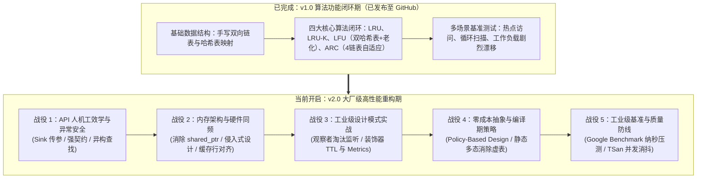

# YsCache 进阶学习路线与大厂级极致重构指南

这份文档专为从“代码复刻/课程作业”向**大厂资深 C++ 研发工程师（L5 / 2-2）架构水准**进阶打造。它将**面向工业级的高性能系统设计、现代 C++ 思维模型、经典工程设计模式**与**全系统极致重构实战（TODO Roadmap）**无缝融合。

---

## 目录
1. [项目里程碑现状与目标](#一-项目里程碑现状与目标)
2. [大厂资深 C++ 工程师核心能力模型](#二-大厂资深-c-工程师核心能力模型)
3. [重构五大战役（TODO Roadmap）](#三-重构五大战役todo-roadmap)
   - [战役 1：API 人机工效学、强契约与异常安全](#战役-1api-人机工效学强契约与异常安全api-ergonomics--exception-safety)
   - [战役 2：内存架构与硬件同频](#战役-2内存架构与硬件同频hardware-conscious-memory-architecture)
   - [战役 3：工业级设计模式实战与可扩展架构](#战役-3工业级设计模式实战与可扩展架构industrial-design-patterns)
   - [战役 4：零成本抽象与编译期策略](#战役-4零成本抽象与编译期策略zero-cost-abstractions--policy-based-design)
   - [战役 5：工业级基准测试与防御性工程体系](#战役-5工业级基准测试与防御性工程体系benchmarking--production-defense)
4. [现代 C++ 核心系统设计思维（Mindset Shift）](#四-现代-c-核心系统设计思维mindset-shift)
5. [C++17 关键语法特性全景速查与实战应用](#五-c17-关键语法特性全景速查与实战应用)
6. [重构前后的性能与架构全方位对比](#六-重构前后的性能与架构全方位对比)

---

## 一、 项目里程碑现状与目标



---

## 二、 大厂资深 C++ 工程师核心能力模型

在顶级科技公司（Google、腾讯、字节、微软）的代码评审中，评估一个基础设施库的标准绝不仅是“跑通测试用例”，而是严格审视以下四大维度：

1. **API 人机工效学（Ergonomics & API Design）**：
   - 接口是否“防呆”？是否让调用者无论传入左值、右值、字面量都能获得最佳性能？
   - 避免暴露内部实现细节，实现强契约与类型安全。
2. **底层硬件与内存同频（Hardware-Conscious）**：
   - 深知内存层次结构（L1/L2/L3 Cache、CPU Cache Line 64 字节）。
   - 杜绝多线程下的**伪共享（False Sharing）**颠簸与频繁的堆内存碎片。
   - 识别隐藏的原子操作总线锁（如 `shared_ptr` 拷贝产生的原子 CAS 开销）。
3. **工程设计模式与正交解耦（Orthogonal System Architecture）**：
   - 拒绝大杂烩式的上帝类（God Class），遵循单一职责原则（SRP）。
   - 运用 **策略模式（Policy-Based）**、**装饰器模式（Decorator）**、**观察者模式（Observer）** 构建高内聚、低耦合、像乐高积木一样可自由扩展的缓存组件。
4. **防御性工程与严苛质量网（Defensive Engineering & Resilience）**：
   - 提供**强异常安全保证（Strong Exception Guarantee）**：即使外部用户自定义类型的构造/拷贝抛出异常，内部状态也绝不损坏、内存绝不泄漏。
   - 结合 Sanitizer 家族（ASan, TSan, UBSan）与纳秒级微基准测试（Google Benchmark），用数据证明性能优势。

---

## 三、 重构五大战役（TODO Roadmap）

### 战役 1：API 人机工效学、强契约与异常安全（API Ergonomics & Exception Safety）
- [x] **1.1 纯化核心策略接口 `YsCachePolicy`**：
  - 规范接口签名，确立现代 C++ **Sink Argument 传值模式**（接收 `Key key, Value value`，内部 `std::move`）；
  - 全面采用 **`std::optional<Value>`** 表达查询结果，消灭魔鬼数值与裸指针；
  - 统一容器基础状态查询方法：`size()`、`capacity()`、`empty()`、`clear()`。
- [ ] **1.2 引入异构查找（Heterogeneous Lookup，零拷贝查询）**：
  - 在键为 `std::string` 时，支持直接传入 `std::string_view` 或 `const char*` 执行 `get` 与 `remove`；
  - 避免仅为了查询 key 是否存在而触发多余的临时堆内存分配（`std::string` 构造）。
- [x] **1.3 强异常安全性分析与落地（Strong Exception Safety）**：
  - 严密分析：如果 `Key` 或 `Value` 的移动构造/拷贝构造抛出异常，缓存内部指针与哈希表是否仍保持强一致？
  - 遵循“先做可能抛异常的准备操作，最后一步提交指针替换”的 Commit-or-Rollback 哲学。
- [x] **1.4 现代属性说明符与类型约束**：
  - 全面使用 `[[nodiscard]]` 标记关键返回值接口（如 `get()`、`remove()`、`empty()`），防止调用方忽略返回值造成逻辑疏漏；
  - 合理标注 `const`、`noexcept`，规范数值类型为 `std::size_t`，清除所有编译告警。

---

### 战役 2：内存架构与硬件同频（Hardware-Conscious Memory Architecture）
- [x] **2.1 彻底根除 `shared_ptr` + `weak_ptr` 原子包袱**：
  - 树立清晰的**唯一所有权（Unique Ownership）模型**：
    - 哈希表是节点的唯一所有者（持有 `std::unique_ptr<Node>`）；
    - 双向链表仅使用**裸观察者指针（`Node* prev`, `Node* next`）**维系访问顺序；
  - 彻底抹平每次节点移到链表头时 `weak_ptr::lock()` 触发的原子 CAS 引用计数总线风暴。
- [x] **2.2 侵入式设计思想（Intrusive Node Layout）与消除内存空洞**：
  - 优化节点内存排布（Struct Packing），紧凑排列指针、频次与数据，去除无用的空洞填充（Padding）；
  - 评估并去除节点内部冗余的 `std::optional` 包装，按需设计紧凑标头。
- [x] **2.3 零堆内存抖动节点穿梭（Zero-Allocation Promotion）**：
  - **LRU-K**：冷队列晋升到热队列时，仅调整指针指向，**严禁 delete 旧节点再 new 新节点**；
  - **LFU**：节点频次递增时，直接跨频次桶穿梭，实现零堆分配的 $\mathcal{O}(1)$ 频次跃迁；
  - **ARC**：$T_1 \to T_2$、$B_1 \to T_2$ 的流转过程中最大限度复用已分配内存。
- [x] **2.4 防 CPU Cache Line 伪共享（Anti-False Sharing）**：
  - 多核高并发分片（`ShardedCache`）中，确保各分片的互斥锁与核心计数器独占独立的 64 字节 CPU Cache Line；
  - 应用 `alignas(64)` 或 `std::hardware_destructive_interference_size`，彻底杜绝核间缓存一致性协议（MESI）总线颠簸。

---

### 战役 3：工业级设计模式实战与可扩展架构（Industrial Design Patterns）
- [x] **3.1 观察者模式（Observer Pattern）—— 淘汰监听与数据落盘**：
  - 设计通用的淘汰监听器：`using EvictionCallback = std::function<void(const Key&, const Value&)>;`；
  - 当数据被 LRU、LFU、ARC 策略逐出物理缓存时，触发回调通知应用层（如写回 MySQL/SSD、清理关联资源）。
- [x] **3.2 装饰器模式（Decorator Pattern）—— 无侵入能力叠加**：
  - **TTL 装饰器（`TtlCacheDecorator`）**：在不修改底层 LRU/ARC 任何核心逻辑的前提下，通过透明包装外层，为缓存无侵入叠加“按时间自动过期”能力；
  - **监控装饰器（`MetricsCacheDecorator`）**：无侵入统计请求吞吐量、实时命中率、P99 延迟等运维指标。
- [x] **3.3 建造者模式与流式工厂（Builder & Fluent API）**：
  - 实现易用优雅的 `CacheBuilder`：
    ```cpp
    auto cache = CacheBuilder<std::string, UserProfile>()
                     .WithCapacity(10000)
                     .WithPolicy(PolicyType::ARC)
                     .WithTtl(std::chrono::minutes(30))
                     .WithEvictionListener([](const auto& k, const auto& v) { ... })
                     .Build();
    ```

---

### 战役 4：零成本抽象与编译期策略（Zero-Cost Abstractions & Policy-Based Design）
- [x] **4.1 编译期策略类设计（Andrei Alexandrescu Policy-Based Class Design）**：
  - 将缓存正交解耦为三大正交维度：
    - `StoragePolicy`（紧凑哈希表、分片哈希表、外部存储）；
    - `EvictionPolicy`（LRU、LFU、ARC、FIFO）；
    - `ConcurrencyPolicy`（无锁单线程、互斥锁多线程、读写锁、分段锁）；
  - 允许在编译期自由组合生成定制化类，彻底摆脱动态虚函数表（`vtable`）调用开销与指针跳转，实现极限编译器内联（Inline）。
- [ ] **4.2 静态多态与 CRTP（Curiously Recurring Template Pattern）**：
  - 为需要通用基类派生的结构引入静态多态，在零运行时开销下获得优雅的接口约束。
- [x] **4.3 C++17 SFINAE 与 Type Traits 契约防御**：
  - 使用 `std::is_copy_constructible_v`、`std::is_nothrow_move_constructible_v` 等类型萃取，在编译期给出清晰明了的静态断言（`static_assert`）报错提示。

---

### 战役 5：工业级基准测试与防御性工程体系（Benchmarking & Production Defense）
- [x] **5.1 引入 Google Benchmark（纳秒级微基准压测）**：
  - 搭建专业级基准测试流水线，精准测量不同数据规模下的：
    - 单次 Read / Write 平均延迟（ns/op）；
    - CPU 指令周期（CPU Cycles）与吞吐量（Ops/sec）；
    - 重构前后 `shared_ptr` vs 裸指针的微秒级吞吐倍率对比。
- [ ] **5.2 ThreadSanitizer (TSan) 并发数据竞态排查**：
  - 编写高压力、多线程极端穿插的压测用例，通过 `-fsanitize=thread` 确保**绝对零数据竞态（Data Race Free）**。
- [x] **5.3 生产级 CI/CD 自动化流水线（GitHub Actions）**：
  - 配置自动化持续集成脚本，确保跨平台（Linux GCC / Clang, macOS AppleClang）全矩阵构建通过；
  - 自动运行 ASan / TSan / UBSan 与单元测试覆盖率检查。

---

## 四、 现代 C++ 核心系统设计思维（Mindset Shift）

### 1. 独占所有权模型（Exclusive Ownership & Observer Pattern）
* **破除误区**：“现代 C++ 意味着到处使用 `std::shared_ptr`。”
* **正解**：
  * **唯一所有者（Owner）**：节点归哈希表管理，使用 `std::unique_ptr` 托管生命周期。
  * **观察者（Observer）**：双向链表的前后指针只负责维护流转顺序，不负责生命周期，**首选裸指针（`Node*`）**。
  * 在锁保护的互斥区域内，裸指针是绝对安全的，且彻底摆脱了 `shared_ptr` 内部每次原子引用计数增减引发的总线同步开销（Lock Prefix CAS）。

### 2. 零法则（The Rule of Zero）与 RAII 纯净化
* **理念**：如果类的成员全部由现代 RAII 资源管理者（`std::unique_ptr`, `std::vector`, `std::unordered_map`, `std::mutex`）托管，**绝不手写析构函数、拷贝构造与赋值操作符**。
* 编译器自动合成的特殊成员函数是最高效、强异常安全且不会发生死锁与泄漏的。

### 3. Sink Argument 模式与移动语义（Move Semantics）
* **最佳实践**：
  ```cpp
  // 最佳入参设计：通过值传递接受实参（Sink）
  void put(Key key, Value value) {
      // 外部传入左值时深拷贝一次，传入右值时零拷贝移动
      // 内部一律通过 std::move 转移所有权给底层节点
      map_[std::move(key)] = std::move(value);
  }
  ```
  相比繁冗地重载 `const T&` 和 `T&&` 两套模板，代码极其精简，且对右值调用实现了真正的零多余拷贝。

### 4. 强异常安全保证（Strong Exception Guarantee）
* **Commit-or-Rollback 哲学**：
  - 在执行状态更新前，先完成所有可能抛出异常的操作（如堆内存申请、用户类型构造）；
  - 一旦所有可能失败的步骤成功，再通过 `noexcept` 的指针调换一次性提交修改；
  - 如果途中发生异常，缓存内部原有数据与拓扑结构丝毫不受破坏。

---

## 五、 C++17 关键语法特性全景速查与实战应用

### 1. 结构化绑定（Structured Bindings）与单次哈希插入
```cpp
// 避免 find 后再 insert 的两次哈希计算，一步到位
auto [it, inserted] = cacheMap_.try_emplace(std::move(key), std::move(nodePtr));
if (!inserted) {
    // 键已存在，直接就地更新，无需重新查找
    it->second->value = std::move(value);
}
```

### 2. 带初始化语句的 `if` / `switch`（Init-statement）
```cpp
// 将查找迭代器的生命周期严格锁定在 if 作用域内，杜绝变量泄漏污染
if (auto it = cacheMap_.find(key); it != cacheMap_.end()) {
    moveToHead(it->second.get());
    return it->second->value;
}
```

### 3. `std::optional<T>` 与函数式处理
```cpp
std::optional<Value> get(const Key &key);

// 调用方利用 value_or 优雅提供缺省回退：
Value theme = cache.get("theme").value_or("dark_mode");
```

### 4. 类模板实参推导（CTAD）与死锁规避
```cpp
// 自动推导互斥锁类型
std::lock_guard lock(mutex_);

// 同时获取两把及以上锁时，使用 scoped_lock 防死锁
std::scoped_lock lock(mutexA, mutexB);
```

### 5. `alignas` 硬件级缓存行对齐（防伪共享）
```cpp
#include <new>

// 确保每个分片独占 64 字节 Cache Line
struct alignas(64) Shard {
    std::mutex mtx;
    std::unordered_map<Key, NodePtr> map;
    // ...
};
```

### 6. `[[nodiscard]]` 属性修饰
```cpp
[[nodiscard]] bool empty() const noexcept;
[[nodiscard]] bool remove(const Key &key);
[[nodiscard]] std::optional<Value> get(const Key &key);
```

---

## 六、 重构前后的性能与架构全方位对比

| 指标 / 维度 | v1.0 现状（初学者/教程风格） | v2.0 终极重构（大厂工业级风格） |
| :--- | :--- | :--- |
| **内存所有权** | 模糊，`shared_ptr` 与 `weak_ptr` 循环缠绕 | 清晰严谨，`unique_ptr` 独占拥有，裸指针观察 |
| **热点操作成本** | 包含原子 CAS 引用计数操作（总线锁争用） | 纯粹的纳秒级裸指针地址替换（**零原子开销**） |
| **多级队列锁粒度** | 一次操作经历 **3 ~ 5 次** 加锁/解锁系统调用 | 一次操作精确 **1 次** 加锁/解锁 |
| **队列晋升开销** | 释放旧节点堆内存，再申请新节点堆内存（堆抖动） | 仅在双向链表间调整指针位置（**零堆内存分配**） |
| **哈希查找次数** | 嵌套查找，一次操作需查 2 ~ 3 次哈希表 | 精确 **1 次** 哈希查找（结构化绑定 + `try_emplace`） |
| **并发伪共享** | 依赖堆分配器随机排布，各核 Cache Line 互相失效颠簸 | `alignas(64)` 显式对齐，各核心缓存行完全物理隔离 |
| **系统可扩展性** | 功能硬编码，扩展 TTL、指标需修改核心算法代码 | **装饰器模式** 无侵入叠加 TTL、Metrics；**观察者模式** 解耦淘汰监听 |
| **抽象层开销** | 纯运行时虚函数表（`vtable`），无法内联优化 | 支持 **Policy-Based Design** 编译期组合，零虚表开销，极限内联 |
| **工程质量保障** | 基础功能验证 | Google Benchmark 纳秒微基准 + ASan/TSan 并发无死角压测 |

---

> [!TIP]
> **实战推进法则**：
> 从现在起，我们进入大厂级代码实战推进阶段！每一次改动都将包含**底层汇编/原理分析、设计模式应用、手写现代代码与严谨验证**。随时欢迎提出任何疑问，让我们把每一个细节彻底打磨透彻！
